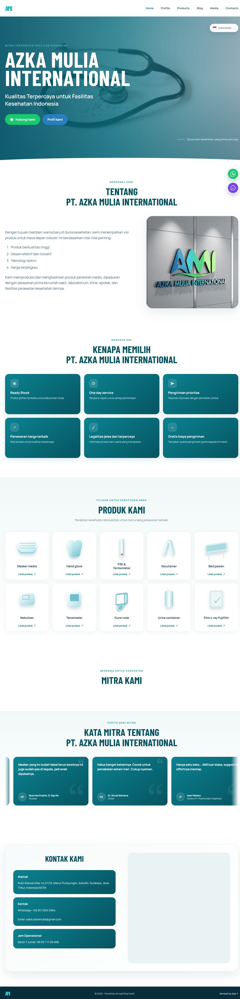
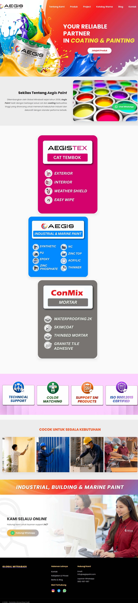

<div align="center">

# AZKA MULIA INTERNATIONAL

Website profil dan katalog produk alat kesehatan PT. Azka Mulia International.

[](https://azkamulia.vercel.app/)


</div>

<p align="center">
  
</p>

<details>
  <summary>Preview tambahan — Aegis Paint</summary>
  <br>
  
</details>

## Tentang proyek

Website ini memperkenalkan PT. Azka Mulia International dan menyediakan informasi produk serta cara menghubungi tim perusahaan. Tampilannya dirancang agar tetap nyaman digunakan di desktop, tablet, dan ponsel.

## Fitur

- Navigasi responsif dengan menu mobile.
- Profil perusahaan dan nilai layanan.
- Katalog kategori produk alat kesehatan.
- Informasi mitra dan testimoni.
- Alamat, kontak, peta lokasi, dan tombol WhatsApp.

## Teknologi

- HTML5
- CSS3 (layout responsif dengan Grid, Flexbox, dan media query)
- JavaScript

## Menjalankan secara lokal

Tidak diperlukan proses build atau instalasi dependensi.

1. Clone repository ini.
2. Buka `index.html` di browser, atau letakkan folder proyek di `htdocs` jika menggunakan XAMPP.
3. Untuk XAMPP, akses `http://localhost/tokofil3/`.

## Struktur proyek

```text
.
├── assets/
│   ├── aegis-paint-preview.png
│   └── website-preview.png
├── index.html
├── script.js
├── style.css
└── README.md
```

## Demo

[Lihat website Azka Mulia International](https://azkamulia.vercel.app/)
